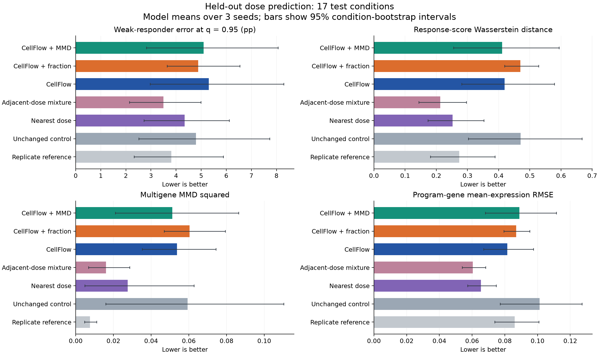

# CellFlow v1: held-out-dose results

The completed experiment includes standard CellFlow, CellFlow + response-fraction loss,
and CellFlow + MMD, with three seeds each. This is a CellFlow-based implementation using
`cellflow-tools==0.0.9`, not a reproduction of all settings in the original paper.

- [Results, methods, uncertainty and limitations](v1/report/cellflow-v1-report.txt)
- [All metric summaries, including references](v1/report/all_metric_summaries.csv)
- [Per-condition and per-seed metrics](v1/report/all_per_condition_metrics.csv)
- [Exact saved code and reproduction instructions](../../experiments/cellflow_v1/README.md)
- [Comparison protocol for chemCPA and CellFlow](COMPARABILITY.md)
- [Checkpoint and prediction index](v1/model_index.json)

## Test results

Equal-weight means over 17 withheld-dose conditions; mean ± sample SD over seeds.
Errors are computed separately for each seed before averaging. WRF errors are percentage
points. Seed SD includes model training and sampled-control variation; it is not a
confidence interval across independent biological experiments.

| Metric (lower is better) | CellFlow | CellFlow + WRF loss (3 thresholds) | CellFlow + MMD |
|---|---:|---:|---:|
| wrf_err_pp_q0.9 | 10.5170 ± 1.6785 | 9.0888 ± 2.1308 | 9.6418 ± 0.6820 |
| wrf_err_pp_q0.95 | 5.3002 ± 1.0232 | 4.8810 ± 1.1133 | 5.0957 ± 0.8215 |
| wrf_err_pp_q0.975 | 7.4098 ± 0.0000 | 7.3370 ± 0.0633 | 7.4098 ± 0.0000 |
| w1_r | 0.4188 ± 0.0288 | 0.4696 ± 0.0954 | 0.4110 ± 0.0331 |
| mmd2 | 0.0538 ± 0.0276 | 0.0605 ± 0.0138 | 0.0512 ± 0.0007 |
| rmse_mean_all | 0.0917 ± 0.0214 | 0.0788 ± 0.0131 | 0.0883 ± 0.0011 |
| rmse_mean_deg50 | 0.2841 ± 0.0380 | 0.3031 ± 0.0642 | 0.3741 ± 0.0025 |
| rmse_mean_program | 0.0815 ± 0.0042 | 0.0869 ± 0.0100 | 0.0888 ± 0.0017 |

The fraction-loss primary difference versus CellFlow is -0.4192 pp, with a paired
condition-bootstrap 95% interval of [-1.9522, +0.9710]. W1 and MMD worsen with fraction
loss. These are exploratory results with an inconclusive primary gain. The adjacent-dose
mixture reference has primary error 3.4947 pp; vehicle is 4.7928 pp. Replicate disagreement
is a reference, not a strict lower bound. Full references and intervals are in the CSV.

The subsequent [three-seed 3-versus-13-threshold comparison](q13_repair_20261030/report/comparison_report.txt)
is now complete. It reruns both WRF variants after a numerical precision repair and
reports the actual 13-threshold mean, using per-seed errors before averaging for every
model. The original v1 numbers above remain unchanged. See the
[repair, verification and reproduction record](../../experiments/cellflow_q13_repair_20261030/README.txt)
for the new experiment's implementation and limitations.

## Data, provenance and artifacts

Panel: 24,786 A549 cells, 2,085 frozen evaluation genes, 26 HDAC inhibitors at 24 hours.
The split has 15,625 treated training cells, 3,773 vehicle controls, 2,034 validation cells
in 9 conditions, and 3,354 test cells in 17 conditions. The task is interpolation to a
withheld dose of a known drug, not generalization to an unseen drug or cell type.

Evaluator: `1d8b173f8d4120c8ba4487d7e03511b26e7a71ad`.
Models, predictions, per-well metrics and per-cell response scores remain in the PSC
shared archive:

`/ocean/projects/cis260266p/shared/response-fraction/results/cellflow_vc_wrf_v1_50003709`

Data panel:
`/ocean/projects/cis260266p/shared/response-fraction/data/processed/a549_hdaci_v1.h5ad`

The GitHub package contains source, configuration, environment lock, summaries,
per-condition/per-seed results, figures, validation selection records and verification
records. It does not contain the large checkpoint or prediction files. The original
run-relative hashes in `v1/final_artifact_sha256.json` describe the full PSC run; the
separate `v1/publication_manifest.json` describes files published in this branch.
`v1/published_source_provenance.json` maps published source files to the original hashes.

The cluster checks are preserved records from the completed October 29 experiment.
Publishing this package did not retrain models or change the test predictions.
