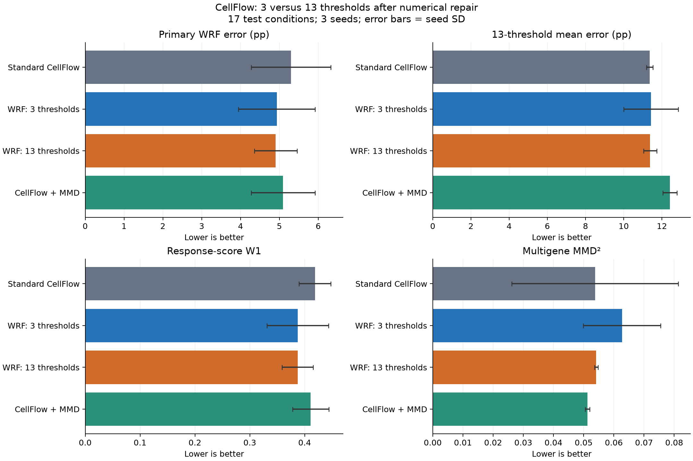

# CellFlow: matched three-seed numerical precision reruns

Both WRF variants completed seeds 0, 1 and 2 for 30,000 updates each. The auxiliary
trajectory and scoring use float64; the base flow loss, parameters and optimizer
remain float32. Other training settings and the evaluation protocol are unchanged.
The standard CellFlow and MMD rows are archived v1 references, rescored unchanged.

Equal-condition test means over 17 conditions and three seeds; ± is sample seed SD.
WRF errors are percentage points. All columns are lower-is-better. References have
one fixed evaluation rather than three training seeds.

| Method | WRF q=.95 (pp) | 13-threshold mean (pp) | W1 | MMD² | DEG50 RMSE | Program RMSE |
|---|---:|---:|---:|---:|---:|---:|
| Standard CellFlow (archived) | 5.30 ± 1.02 | 11.36 | 0.419 | 0.0538 | 0.284 | 0.0815 |
| CellFlow + WRF, 3 thresholds (repaired) | 4.93 ± 0.99 | 11.43 | 0.387 | 0.0627 | 0.337 | 0.0822 |
| CellFlow + WRF, 13 thresholds (repaired) | 4.91 ± 0.55 | 11.38 | 0.387 | 0.0542 | 0.371 | 0.0849 |
| CellFlow + MMD (archived) | 5.10 ± 0.82 | 12.42 | 0.411 | 0.0512 | 0.374 | 0.0888 |
| Vehicle cells | 4.79 | 14.98 | 0.471 | 0.0594 | 0.447 | 0.1012 |
| Nearest dose | 4.34 | 6.64 | 0.253 | 0.0275 | 0.269 | 0.0653 |
| Adjacent-dose mixture | 3.49 | 5.42 | 0.213 | 0.0161 | 0.198 | 0.0605 |
| Replicate disagreement | 3.81 | 7.98 | 0.273 | 0.0076 | 0.245 | 0.0860 |

The 13-versus-3 primary difference is -0.0260 pp (paired condition-bootstrap
95% interval [-0.4710, +0.4150]). This is not clear evidence of an overall gain.
MMD decreases in the mean, W1 is essentially unchanged, and DEG50/program errors
increase. The adjacent-dose mixture remains a stronger reference on these metrics.

## Which numbers belong together?

| 3-threshold WRF version | Seed 0 | Seed 1 | Seed 2 | Mean ± SD (pp) |
|---|---:|---:|---:|---:|
| Original float32 auxiliary calculation | 3.8248 | 4.7745 | 6.0437 | 4.8810 ± 1.1133 |
| Float64 auxiliary precision rerun | 4.1490 | 4.6044 | 6.0437 | 4.9324 ± 0.9890 |

The earlier incomplete 13-threshold table used seed 0 for both arms because only
that 13-threshold seed completed. It was not a three-seed summary.

## Evidence and limits

- [All nine metrics, intervals and limitations](report/comparison_report.txt)
- [Metric means and seed SDs](report/metric_summary.csv)
- [Per-seed/per-condition measurements](report/all_per_condition_metrics.csv)
- [Training and selected checkpoints](report/training_summary.csv)
- [Numerical repair and exact archived code](../../../experiments/cellflow_q13_repair_20261030/README.txt)
- [PSC models, predictions and logs](shared_package.json)
- [Cross-model comparison caveats](../COMPARABILITY.md)

This is exploratory work after earlier test results were seen. Higher precision
prevented crashes but did not establish accurate 8-step auxiliary trajectories:
a captured trajectory still reached about 1.6e43. Seed-0 validation predictions
passed the planned 64-versus-128-step integration check for each arm. The q=.975
cutoff lies at the zero-program-count boundary. Preserve these limitations.

Archived records saying `no_github_push` describe the October 30 experiment state;
they are preserved historical provenance, not a statement about this publication.

