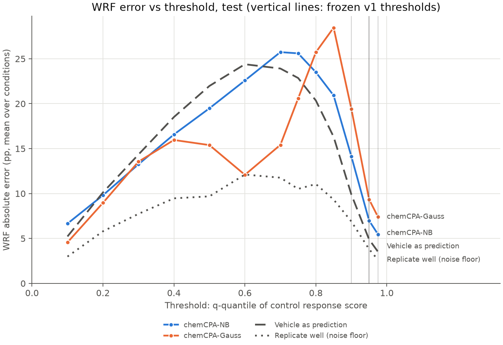

# chemCPA comparison: test

Frozen v1 metrics, equal-weight mean over conditions; model rows are mean ± SD over seeds (sampling offset 0). Vehicle and replicate rows are the shared references. Primary metric: wrf_err_pp_q0.95.

| Method | wrf_err_pp_q0.9 | wrf_err_pp_q0.95 | wrf_err_pp_q0.975 | w1_r | mmd2 | rmse_mean_all | rmse_mean_deg50 | rmse_mean_program |
|---|---:|---:|---:|---:|---:|---:|---:|---:|
| chemCPA-NB | 14.3157 ± 0.9700 | 7.1336 ± 0.4538 | 5.6020 ± 0.3800 | 0.5890 ± 0.0396 | 0.0494 ± 0.0022 | 0.0804 ± 0.0009 | 0.3928 ± 0.0034 | 0.1019 ± 0.0062 |
| chemCPA-Gauss | 19.4319 ± 0.1035 | 9.3461 ± 0.0000 | 7.4098 ± 0.0000 | 0.6012 ± 0.0021 | 0.0334 ± 0.0038 | 0.0713 ± 0.0024 | 0.3078 ± 0.0161 | 0.0721 ± 0.0025 |
| Vehicle as prediction | 9.8970 | 4.8904 | 3.5253 | 0.4755 | 0.0586 | 0.0817 | 0.4362 | 0.0986 |
| Replicate well (noise floor) | 6.8934 | 3.8106 | 2.6269 | 0.2732 | 0.0076 | 0.0677 | 0.2447 | 0.0860 |

## Supplementary: WRF error (pp) across control-quantile thresholds

| q | measured WRF | chemCPA-NB | chemCPA-Gauss | Vehicle as prediction | Replicate well (noise floor) |
|---:|---:|---:|---:|---:|---:|
| 0.1 | 4.9% | 6.66 | 4.57 | 5.23 | 2.99 |
| 0.2 | 9.9% | 9.81 | 8.96 | 10.12 | 5.80 |
| 0.3 | 15.8% | 13.26 | 13.55 | 14.34 | 7.74 |
| 0.4 | 21.5% | 16.58 | 15.96 | 18.52 | 9.47 |
| 0.5 | 28.0% | 19.49 | 15.39 | 21.97 | 9.69 |
| 0.6 | 35.6% | 22.58 | 12.08 | 24.39 | 12.12 |
| 0.7 | 46.1% | 25.74 | 15.42 | 23.91 | 11.76 |
| 0.75 | 52.1% | 25.60 | 20.58 | 22.86 | 10.52 |
| 0.8 | 59.6% | 23.50 | 25.72 | 20.35 | 11.06 |
| 0.85 | 68.7% | 20.92 | 28.46 | 16.32 | 9.33 |
| 0.9 | 80.5% | 14.14 | 19.43 | 9.90 | 6.89 |
| 0.95 | 90.7% | 6.99 | 9.35 | 4.89 | 3.81 |
| 0.975 | 92.6% | 5.47 | 7.41 | 3.53 | 2.63 |

