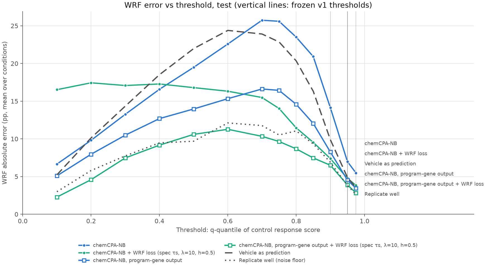

# chemCPA comparison: test

Frozen v1 metrics, equal-weight mean over conditions; model rows are mean ± SD over seeds (sampling offset 0). Vehicle and replicate rows are the shared references. Primary metric: wrf_err_pp_q0.95.

| Method | wrf_err_pp_q0.9 | wrf_err_pp_q0.95 | wrf_err_pp_q0.975 | w1_r | mmd2 | rmse_mean_all | rmse_mean_deg50 | rmse_mean_program |
|---|---:|---:|---:|---:|---:|---:|---:|---:|
| chemCPA-NB | 14.3157 ± 0.9700 | 7.1336 ± 0.4538 | 5.6020 ± 0.3800 | 0.5890 ± 0.0396 | 0.0494 ± 0.0022 | 0.0804 ± 0.0009 | 0.3928 ± 0.0034 | 0.1019 ± 0.0062 |
| chemCPA-NB + WRF loss (spec τs, λ=10, h=0.5) | 7.8969 ± 0.9120 | 5.2727 ± 0.4982 | 4.1495 ± 0.2141 | 0.5087 ± 0.0792 | 0.0490 ± 0.0044 | 0.0908 ± 0.0050 | 0.4195 ± 0.0346 | 0.1353 ± 0.0421 |
| chemCPA-NB, program-gene output | 9.1057 ± 0.9011 | 5.2323 ± 0.0452 | 4.1757 ± 0.2284 | 0.4035 ± 0.0428 | – | – | – | 0.0942 ± 0.0032 |
| chemCPA-NB, program-gene output + WRF loss (spec τs, λ=10, h=0.5) | 6.9770 ± 0.6155 | 4.3087 ± 0.2739 | 3.1016 ± 0.1611 | 0.2816 ± 0.0317 | – | – | – | 0.0717 ± 0.0041 |
| Vehicle as prediction | 9.8970 | 4.8904 | 3.5253 | 0.4755 | 0.0586 | 0.0817 | 0.4362 | 0.0986 |
| Replicate well (noise floor) | 6.8934 | 3.8106 | 2.6269 | 0.2732 | 0.0076 | 0.0677 | 0.2447 | 0.0860 |

## Supplementary: WRF error (pp) across control-quantile thresholds

| q | measured WRF | chemCPA-NB | chemCPA-NB + WRF loss (spec τs, λ=10, h=0.5) | chemCPA-NB, program-gene output | chemCPA-NB, program-gene output + WRF loss (spec τs, λ=10, h=0.5) | Vehicle as prediction | Replicate well (noise floor) |
|---:|---:|---:|---:|---:|---:|---:|---:|
| 0.1 | 4.9% | 6.66 | 16.53 | 5.09 | 2.28 | 5.23 | 2.99 |
| 0.2 | 9.9% | 9.81 | 17.44 | 7.96 | 4.58 | 10.12 | 5.80 |
| 0.3 | 15.8% | 13.26 | 17.08 | 10.49 | 7.47 | 14.34 | 7.74 |
| 0.4 | 21.5% | 16.58 | 17.28 | 12.69 | 9.17 | 18.52 | 9.47 |
| 0.5 | 28.0% | 19.49 | 16.80 | 13.97 | 10.59 | 21.97 | 9.69 |
| 0.6 | 35.6% | 22.58 | 16.32 | 15.33 | 11.27 | 24.39 | 12.12 |
| 0.7 | 46.1% | 25.74 | 15.49 | 16.62 | 10.34 | 23.91 | 11.76 |
| 0.75 | 52.1% | 25.60 | 14.03 | 16.43 | 9.65 | 22.86 | 10.52 |
| 0.8 | 59.6% | 23.50 | 11.46 | 14.59 | 8.68 | 20.35 | 11.06 |
| 0.85 | 68.7% | 20.92 | 9.54 | 12.04 | 7.47 | 16.32 | 9.33 |
| 0.9 | 80.5% | 14.14 | 7.39 | 8.26 | 6.50 | 9.90 | 6.89 |
| 0.95 | 90.7% | 6.99 | 4.76 | 4.54 | 3.90 | 4.89 | 3.81 |
| 0.975 | 92.6% | 5.47 | 3.84 | 3.44 | 2.83 | 3.53 | 2.63 |

–: not scored. Program-gene-output runs generate only the program genes, so MMD² and the all-gene and DEG RMSEs are undefined for them.

## Paired differences (new − ref, per condition, seed-averaged)

Condition bootstrap 95% CI (2000 resamples); the two-level CI also resamples seeds. Negative = the new model has lower error. All metrics: paired_differences.csv.

| ref | new | metric | Δ | 95% CI | two-level CI | new better | seed pairs new better |
|---|---|---|---:|---:|---:|---:|---:|
| nb_v1 | nbwrf_l10_h0.5 | wrf_err_pp_q0.95 | -1.861 | [-4.571, +0.620] | [-4.695, +1.058] | 12/17 | 100% |
| nb_v1 | nbwrf_l10_h0.5 | w1_r | -0.080 | [-0.248, +0.087] | [-0.265, +0.124] | 10/17 | 89% |
| nb_v1 | nbprog_v1 | wrf_err_pp_q0.95 | -1.901 | [-2.922, -0.847] | [-3.281, -0.419] | 13/17 | 100% |
| nb_v1 | nbprog_v1 | w1_r | -0.186 | [-0.251, -0.119] | [-0.286, -0.097] | 16/17 | 100% |
| nb_v1 | nbprogwrf_l10_h0.5 | wrf_err_pp_q0.95 | -2.825 | [-5.154, -0.833] | [-5.312, -0.834] | 14/17 | 100% |
| nb_v1 | nbprogwrf_l10_h0.5 | w1_r | -0.307 | [-0.488, -0.145] | [-0.496, -0.136] | 12/17 | 100% |
| nbwrf_l10_h0.5 | nbprog_v1 | wrf_err_pp_q0.95 | -0.040 | [-2.205, +2.307] | [-2.760, +2.435] | 12/17 | 67% |
| nbwrf_l10_h0.5 | nbprog_v1 | w1_r | -0.105 | [-0.244, +0.033] | [-0.281, +0.059] | 12/17 | 100% |
| nbwrf_l10_h0.5 | nbprogwrf_l10_h0.5 | wrf_err_pp_q0.95 | -0.964 | [-1.981, -0.033] | [-2.460, +0.413] | 13/17 | 100% |
| nbwrf_l10_h0.5 | nbprogwrf_l10_h0.5 | w1_r | -0.227 | [-0.327, -0.118] | [-0.365, -0.095] | 13/17 | 100% |
| nbprog_v1 | nbprogwrf_l10_h0.5 | wrf_err_pp_q0.95 | -0.924 | [-2.980, +0.579] | [-3.141, +0.790] | 10/17 | 100% |
| nbprog_v1 | nbprogwrf_l10_h0.5 | w1_r | -0.122 | [-0.280, +0.010] | [-0.290, +0.018] | 9/17 | 100% |

