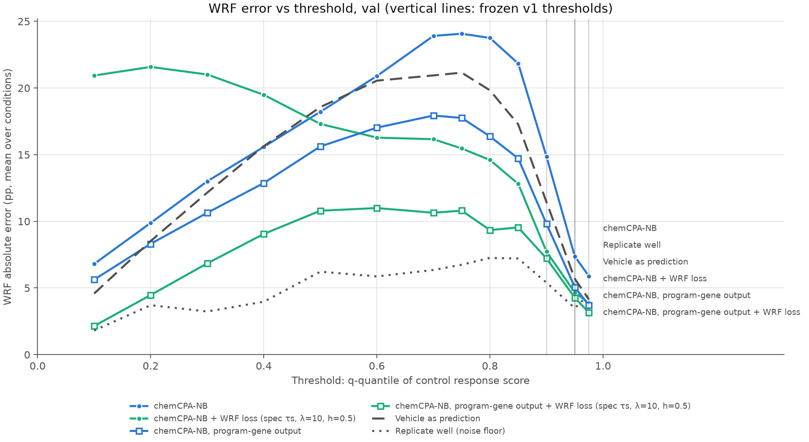

# chemCPA comparison: val

Frozen v1 metrics, equal-weight mean over conditions; model rows are mean ± SD over seeds (sampling offset 0). Vehicle and replicate rows are the shared references. Primary metric: wrf_err_pp_q0.95.

| Method | wrf_err_pp_q0.9 | wrf_err_pp_q0.95 | wrf_err_pp_q0.975 | w1_r | mmd2 | rmse_mean_all | rmse_mean_deg50 | rmse_mean_program |
|---|---:|---:|---:|---:|---:|---:|---:|---:|
| chemCPA-NB | 14.9096 ± 0.5924 | 7.4443 ± 0.2681 | 5.9192 ± 0.2174 | 0.5823 ± 0.0186 | 0.0272 ± 0.0001 | 0.0658 ± 0.0003 | 0.3223 ± 0.0050 | 0.0947 ± 0.0025 |
| chemCPA-NB + WRF loss (spec τs, λ=10, h=0.5) | 8.7413 ± 0.9699 | 4.9458 ± 0.0442 | 4.1787 ± 0.3590 | 0.5842 ± 0.1305 | 0.0252 ± 0.0037 | 0.0735 ± 0.0064 | 0.3390 ± 0.0514 | 0.1438 ± 0.0529 |
| chemCPA-NB, program-gene output | 10.1912 ± 2.0002 | 5.4820 ± 1.1691 | 4.0800 ± 1.0223 | 0.4287 ± 0.0609 | – | – | – | 0.0924 ± 0.0042 |
| chemCPA-NB, program-gene output + WRF loss (spec τs, λ=10, h=0.5) | 7.8019 ± 0.8189 | 4.5194 ± 0.3188 | 3.3797 ± 0.2689 | 0.3059 ± 0.0333 | – | – | – | 0.0651 ± 0.0045 |
| Vehicle as prediction | 11.4359 | 5.6932 | 4.1325 | 0.4645 | 0.0288 | 0.0620 | 0.3322 | 0.0876 |
| Replicate well (noise floor) | 5.3982 | 3.4919 | 4.5073 | 0.2202 | 0.0032 | 0.0565 | 0.1959 | 0.0777 |

## Supplementary: WRF error (pp) across control-quantile thresholds

| q | measured WRF | chemCPA-NB | chemCPA-NB + WRF loss (spec τs, λ=10, h=0.5) | chemCPA-NB, program-gene output | chemCPA-NB, program-gene output + WRF loss (spec τs, λ=10, h=0.5) | Vehicle as prediction | Replicate well (noise floor) |
|---:|---:|---:|---:|---:|---:|---:|---:|
| 0.1 | 5.9% | 6.80 | 20.94 | 5.63 | 2.15 | 4.58 | 1.81 |
| 0.2 | 11.9% | 9.88 | 21.58 | 8.32 | 4.47 | 8.52 | 3.71 |
| 0.3 | 18.0% | 13.00 | 21.01 | 10.64 | 6.85 | 12.15 | 3.24 |
| 0.4 | 24.8% | 15.59 | 19.49 | 12.87 | 9.05 | 15.64 | 3.97 |
| 0.5 | 32.3% | 18.22 | 17.31 | 15.62 | 10.79 | 18.57 | 6.22 |
| 0.6 | 39.5% | 20.90 | 16.28 | 17.02 | 11.00 | 20.55 | 5.87 |
| 0.7 | 49.1% | 23.91 | 16.16 | 17.93 | 10.64 | 20.94 | 6.35 |
| 0.75 | 54.7% | 24.07 | 15.47 | 17.76 | 10.80 | 21.15 | 6.74 |
| 0.8 | 60.3% | 23.75 | 14.60 | 16.37 | 9.34 | 19.83 | 7.26 |
| 0.85 | 68.4% | 21.83 | 12.81 | 14.71 | 9.54 | 17.27 | 7.21 |
| 0.9 | 80.0% | 14.85 | 7.73 | 9.81 | 7.21 | 11.44 | 5.40 |
| 0.95 | 90.5% | 7.37 | 4.66 | 5.07 | 4.27 | 5.69 | 3.49 |
| 0.975 | 92.5% | 5.88 | 3.86 | 3.70 | 3.15 | 4.13 | 4.51 |

–: not scored. Program-gene-output runs generate only the program genes, so MMD² and the all-gene and DEG RMSEs are undefined for them.

## Paired differences (new − ref, per condition, seed-averaged)

Condition bootstrap 95% CI (2000 resamples); the two-level CI also resamples seeds. Negative = the new model has lower error. All metrics: paired_differences.csv.

| ref | new | metric | Δ | 95% CI | two-level CI | new better | seed pairs new better |
|---|---|---|---:|---:|---:|---:|---:|
| nb_v1 | nbwrf_l10_h0.5 | wrf_err_pp_q0.95 | -2.499 | [-4.488, -0.809] | [-4.619, -0.669] | 7/9 | 100% |
| nb_v1 | nbwrf_l10_h0.5 | w1_r | +0.002 | [-0.229, +0.258] | [-0.241, +0.307] | 5/9 | 67% |
| nb_v1 | nbprog_v1 | wrf_err_pp_q0.95 | -1.962 | [-3.308, -0.313] | [-4.391, -0.313] | 7/9 | 100% |
| nb_v1 | nbprog_v1 | w1_r | -0.154 | [-0.244, -0.064] | [-0.294, -0.058] | 7/9 | 100% |
| nb_v1 | nbprogwrf_l10_h0.5 | wrf_err_pp_q0.95 | -2.925 | [-4.402, -1.389] | [-4.542, -1.324] | 7/9 | 100% |
| nb_v1 | nbprogwrf_l10_h0.5 | w1_r | -0.276 | [-0.465, -0.078] | [-0.471, -0.068] | 6/9 | 100% |
| nbwrf_l10_h0.5 | nbprog_v1 | wrf_err_pp_q0.95 | +0.536 | [-0.569, +1.634] | [-1.502, +2.285] | 3/9 | 33% |
| nbwrf_l10_h0.5 | nbprog_v1 | w1_r | -0.156 | [-0.340, +0.030] | [-0.421, +0.056] | 6/9 | 89% |
| nbwrf_l10_h0.5 | nbprogwrf_l10_h0.5 | wrf_err_pp_q0.95 | -0.426 | [-1.715, +0.683] | [-2.051, +0.971] | 6/9 | 100% |
| nbwrf_l10_h0.5 | nbprogwrf_l10_h0.5 | w1_r | -0.278 | [-0.371, -0.176] | [-0.471, -0.127] | 9/9 | 100% |
| nbprog_v1 | nbprogwrf_l10_h0.5 | wrf_err_pp_q0.95 | -0.963 | [-1.862, +0.084] | [-2.509, +1.089] | 7/9 | 67% |
| nbprog_v1 | nbprogwrf_l10_h0.5 | w1_r | -0.123 | [-0.241, +0.002] | [-0.273, +0.015] | 5/9 | 100% |

