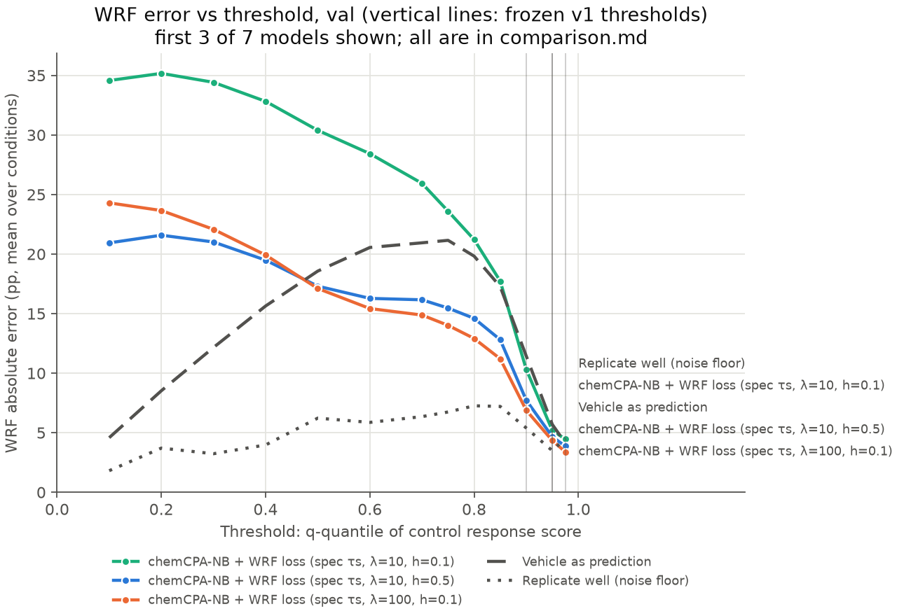

# chemCPA comparison: val

Frozen v1 metrics, equal-weight mean over conditions; model rows are mean ± SD over seeds (sampling offset 0). Vehicle and replicate rows are the shared references. Primary metric: wrf_err_pp_q0.95.

| Method | wrf_err_pp_q0.9 | wrf_err_pp_q0.95 | wrf_err_pp_q0.975 | w1_r | mmd2 | rmse_mean_all | rmse_mean_deg50 | rmse_mean_program |
|---|---:|---:|---:|---:|---:|---:|---:|---:|
| chemCPA-NB + WRF loss (spec τs, λ=10, h=0.1) | 10.6117 ± 1.6647 | 5.3627 ± 0.2829 | 4.6758 ± 0.2047 | 0.9056 ± 0.1392 | 0.0336 ± 0.0005 | 0.0943 ± 0.0014 | 0.4592 ± 0.0275 | 0.2820 ± 0.0039 |
| chemCPA-NB + WRF loss (spec τs, λ=10, h=0.5) | 8.7413 ± 0.9699 | 4.9458 ± 0.0442 | 4.1787 ± 0.3590 | 0.5842 ± 0.1305 | 0.0252 ± 0.0037 | 0.0735 ± 0.0064 | 0.3390 ± 0.0514 | 0.1438 ± 0.0529 |
| chemCPA-NB + WRF loss (spec τs, λ=100, h=0.1) | 7.5319 ± 1.5409 | 4.7840 ± 0.8849 | 3.8513 ± 0.6979 | 0.6374 ± 0.2043 | 0.0332 ± 0.0046 | 0.1308 ± 0.0071 | 0.4741 ± 0.0641 | 0.3408 ± 0.0180 |
| chemCPA-NB + WRF loss (spec τs, λ=100, h=0.5) | 7.3529 ± 0.4665 | 4.6048 ± 0.3403 | 3.5129 ± 0.1367 | 0.4698 ± 0.0638 | 0.0289 ± 0.0032 | 0.1304 ± 0.0173 | 0.3667 ± 0.0128 | 0.3035 ± 0.0220 |
| chemCPA-NB + WRF loss (spec τs, λ=1000, h=0.1) | 8.4871 ± 1.9576 | 5.4031 ± 1.3416 | 4.0391 ± 1.0970 | 0.4140 ± 0.0611 | 0.0622 ± 0.0019 | 0.1969 ± 0.0034 | 0.5195 ± 0.0323 | 0.2785 ± 0.0234 |
| chemCPA-NB + WRF loss (spec τs, λ=1000, h=0.5) | 7.7265 ± 1.6172 | 4.9824 ± 0.8376 | 3.8319 ± 0.4990 | 0.4317 ± 0.1070 | 0.0555 ± 0.0054 | 0.1973 ± 0.0095 | 0.5037 ± 0.0317 | 0.2964 ± 0.0160 |
| chemCPA-NB | 14.9096 ± 0.5924 | 7.4443 ± 0.2681 | 5.9192 ± 0.2174 | 0.5823 ± 0.0186 | 0.0272 ± 0.0001 | 0.0658 ± 0.0003 | 0.3223 ± 0.0050 | 0.0947 ± 0.0025 |
| Vehicle as prediction | 11.4359 | 5.6932 | 4.1325 | 0.4645 | 0.0288 | 0.0620 | 0.3322 | 0.0876 |
| Replicate well (noise floor) | 5.3982 | 3.4919 | 4.5073 | 0.2202 | 0.0032 | 0.0565 | 0.1959 | 0.0777 |

## Supplementary: WRF error (pp) across control-quantile thresholds

| q | measured WRF | chemCPA-NB + WRF loss (spec τs, λ=10, h=0.1) | chemCPA-NB + WRF loss (spec τs, λ=10, h=0.5) | chemCPA-NB + WRF loss (spec τs, λ=100, h=0.1) | chemCPA-NB + WRF loss (spec τs, λ=100, h=0.5) | chemCPA-NB + WRF loss (spec τs, λ=1000, h=0.1) | chemCPA-NB + WRF loss (spec τs, λ=1000, h=0.5) | chemCPA-NB | Vehicle as prediction | Replicate well (noise floor) |
|---:|---:|---:|---:|---:|---:|---:|---:|---:|---:|---:|
| 0.1 | 5.9% | 34.57 | 20.94 | 24.30 | 15.29 | 8.80 | 11.13 | 6.80 | 4.58 | 1.81 |
| 0.2 | 11.9% | 35.17 | 21.58 | 23.65 | 14.67 | 8.32 | 10.92 | 9.88 | 8.52 | 3.71 |
| 0.3 | 18.0% | 34.42 | 21.01 | 22.08 | 13.52 | 7.99 | 10.93 | 13.00 | 12.15 | 3.24 |
| 0.4 | 24.8% | 32.82 | 19.49 | 19.92 | 12.99 | 7.66 | 10.58 | 15.59 | 15.64 | 3.97 |
| 0.5 | 32.3% | 30.39 | 17.31 | 17.11 | 11.82 | 7.68 | 9.65 | 18.22 | 18.57 | 6.22 |
| 0.6 | 39.5% | 28.43 | 16.28 | 15.43 | 11.27 | 9.17 | 10.29 | 20.90 | 20.55 | 5.87 |
| 0.7 | 49.1% | 25.94 | 16.16 | 14.88 | 12.55 | 10.82 | 10.82 | 23.91 | 20.94 | 6.35 |
| 0.75 | 54.7% | 23.60 | 15.47 | 14.01 | 12.36 | 11.81 | 10.52 | 24.07 | 21.15 | 6.74 |
| 0.8 | 60.3% | 21.22 | 14.60 | 12.91 | 12.12 | 10.70 | 10.19 | 23.75 | 19.83 | 7.26 |
| 0.85 | 68.4% | 17.73 | 12.81 | 11.21 | 11.02 | 10.40 | 10.14 | 21.83 | 17.27 | 7.21 |
| 0.9 | 80.0% | 10.32 | 7.73 | 6.88 | 7.20 | 7.75 | 7.14 | 14.85 | 11.44 | 5.40 |
| 0.95 | 90.5% | 5.19 | 4.66 | 4.34 | 4.41 | 5.21 | 4.74 | 7.37 | 5.69 | 3.49 |
| 0.975 | 92.5% | 4.45 | 3.86 | 3.39 | 3.45 | 3.92 | 3.54 | 5.88 | 4.13 | 4.51 |

