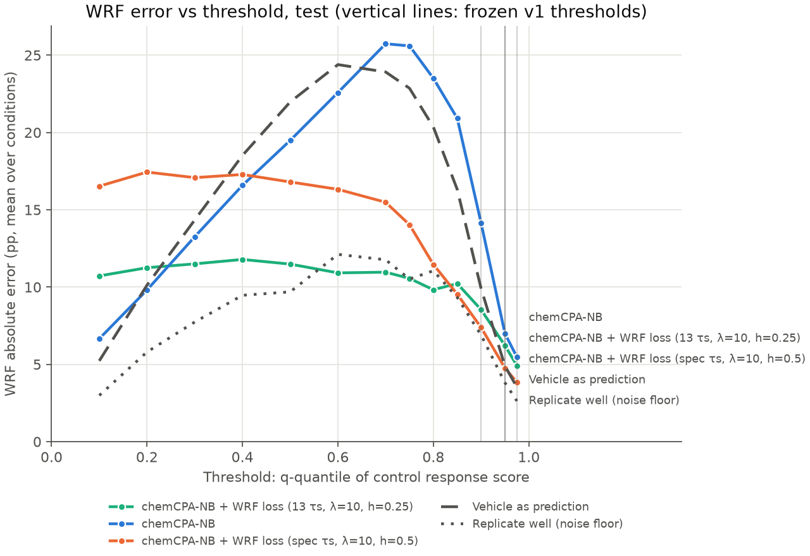

# chemCPA comparison: test

Frozen v1 metrics, equal-weight mean over conditions; model rows are mean ± SD over seeds (sampling offset 0). Vehicle and replicate rows are the shared references. Primary metric: wrf_err_pp_q0.95.

| Method | wrf_err_pp_q0.9 | wrf_err_pp_q0.95 | wrf_err_pp_q0.975 | w1_r | mmd2 | rmse_mean_all | rmse_mean_deg50 | rmse_mean_program |
|---|---:|---:|---:|---:|---:|---:|---:|---:|
| chemCPA-NB + WRF loss (13 τs, λ=10, h=0.25) | 9.1231 ± 0.2750 | 6.5766 ± 0.1679 | 5.0533 ± 0.1508 | 0.4362 ± 0.0550 | 0.0387 ± 0.0061 | 0.0968 ± 0.0075 | 0.4036 ± 0.0233 | 0.1446 ± 0.0168 |
| chemCPA-NB | 14.3157 ± 0.9700 | 7.1336 ± 0.4538 | 5.6020 ± 0.3800 | 0.5890 ± 0.0396 | 0.0494 ± 0.0022 | 0.0804 ± 0.0009 | 0.3928 ± 0.0034 | 0.1019 ± 0.0062 |
| chemCPA-NB + WRF loss (spec τs, λ=10, h=0.5) | 7.8969 ± 0.9120 | 5.2727 ± 0.4982 | 4.1495 ± 0.2141 | 0.5087 ± 0.0792 | 0.0490 ± 0.0044 | 0.0908 ± 0.0050 | 0.4195 ± 0.0346 | 0.1353 ± 0.0421 |
| Vehicle as prediction | 9.8970 | 4.8904 | 3.5253 | 0.4755 | 0.0586 | 0.0817 | 0.4362 | 0.0986 |
| Replicate well (noise floor) | 6.8934 | 3.8106 | 2.6269 | 0.2732 | 0.0076 | 0.0677 | 0.2447 | 0.0860 |

## Supplementary: WRF error (pp) across control-quantile thresholds

| q | measured WRF | chemCPA-NB + WRF loss (13 τs, λ=10, h=0.25) | chemCPA-NB | chemCPA-NB + WRF loss (spec τs, λ=10, h=0.5) | Vehicle as prediction | Replicate well (noise floor) |
|---:|---:|---:|---:|---:|---:|---:|
| 0.1 | 4.9% | 10.72 | 6.66 | 16.53 | 5.23 | 2.99 |
| 0.2 | 9.9% | 11.25 | 9.81 | 17.44 | 10.12 | 5.80 |
| 0.3 | 15.8% | 11.50 | 13.26 | 17.08 | 14.34 | 7.74 |
| 0.4 | 21.5% | 11.79 | 16.58 | 17.28 | 18.52 | 9.47 |
| 0.5 | 28.0% | 11.49 | 19.49 | 16.80 | 21.97 | 9.69 |
| 0.6 | 35.6% | 10.92 | 22.58 | 16.32 | 24.39 | 12.12 |
| 0.7 | 46.1% | 10.96 | 25.74 | 15.49 | 23.91 | 11.76 |
| 0.75 | 52.1% | 10.56 | 25.60 | 14.03 | 22.86 | 10.52 |
| 0.8 | 59.6% | 9.83 | 23.50 | 11.46 | 20.35 | 11.06 |
| 0.85 | 68.7% | 10.23 | 20.92 | 9.54 | 16.32 | 9.33 |
| 0.9 | 80.5% | 8.54 | 14.14 | 7.39 | 9.90 | 6.89 |
| 0.95 | 90.7% | 6.21 | 6.99 | 4.76 | 4.89 | 3.81 |
| 0.975 | 92.6% | 4.92 | 5.47 | 3.84 | 3.53 | 2.63 |

