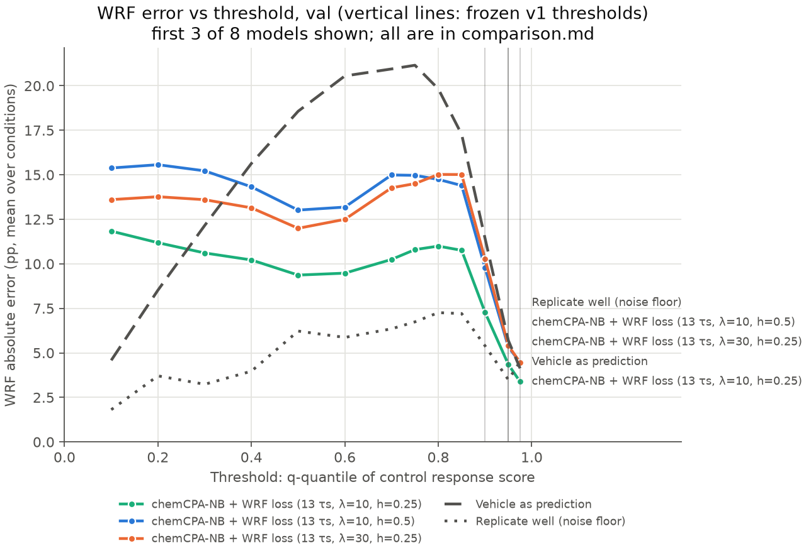

# chemCPA comparison: val

Frozen v1 metrics, equal-weight mean over conditions; model rows are mean ± SD over seeds (sampling offset 0). Vehicle and replicate rows are the shared references. Primary metric: wrf_err_pp_q0.95.

| Method | wrf_err_pp_q0.9 | wrf_err_pp_q0.95 | wrf_err_pp_q0.975 | w1_r | mmd2 | rmse_mean_all | rmse_mean_deg50 | rmse_mean_program |
|---|---:|---:|---:|---:|---:|---:|---:|---:|
| chemCPA-NB + WRF loss (13 τs, λ=10, h=0.25) | 8.2054 ± 2.4115 | 4.7754 ± 0.7472 | 3.9036 ± 0.5688 | 0.4206 ± 0.1036 | 0.0173 ± 0.0016 | 0.0842 ± 0.0074 | 0.3019 ± 0.0134 | 0.1449 ± 0.0129 |
| chemCPA-NB + WRF loss (13 τs, λ=10, h=0.5) | 10.0574 ± 0.3937 | 5.6393 ± 0.1445 | 4.6794 ± 0.1118 | 0.5131 ± 0.0164 | 0.0203 ± 0.0020 | 0.0781 ± 0.0067 | 0.3250 ± 0.0054 | 0.1390 ± 0.0349 |
| chemCPA-NB + WRF loss (13 τs, λ=30, h=0.25) | 10.5390 ± 1.3561 | 5.7406 ± 0.4308 | 4.5656 ± 0.4411 | 0.4955 ± 0.0596 | 0.0212 ± 0.0019 | 0.1288 ± 0.0034 | 0.3829 ± 0.0196 | 0.2113 ± 0.0149 |
| chemCPA-NB + WRF loss (13 τs, λ=30, h=0.5) | 11.4895 ± 2.3328 | 6.2204 ± 0.7583 | 4.9507 ± 0.7062 | 0.5670 ± 0.0927 | 0.0226 ± 0.0027 | 0.1145 ± 0.0125 | 0.3879 ± 0.0137 | 0.1799 ± 0.0511 |
| chemCPA-NB + WRF loss (13 τs, λ=100, h=0.25) | 8.7212 ± 0.6036 | 5.0126 ± 0.6551 | 3.9380 ± 0.3083 | 0.3840 ± 0.0281 | 0.0413 ± 0.0048 | 0.1748 ± 0.0059 | 0.4706 ± 0.0116 | 0.2330 ± 0.0218 |
| chemCPA-NB + WRF loss (13 τs, λ=100, h=0.5) | 9.9390 ± 1.1740 | 5.6780 ± 0.2726 | 4.2775 ± 0.1594 | 0.4579 ± 0.0797 | 0.0358 ± 0.0056 | 0.1647 ± 0.0043 | 0.4429 ± 0.0163 | 0.2371 ± 0.0250 |
| chemCPA-NB | 14.9096 ± 0.5924 | 7.4443 ± 0.2681 | 5.9192 ± 0.2174 | 0.5823 ± 0.0186 | 0.0272 ± 0.0001 | 0.0658 ± 0.0003 | 0.3223 ± 0.0050 | 0.0947 ± 0.0025 |
| chemCPA-NB + WRF loss (spec τs, λ=10, h=0.5) | 8.7413 ± 0.9699 | 4.9458 ± 0.0442 | 4.1787 ± 0.3590 | 0.5842 ± 0.1305 | 0.0252 ± 0.0037 | 0.0735 ± 0.0064 | 0.3390 ± 0.0514 | 0.1438 ± 0.0529 |
| Vehicle as prediction | 11.4359 | 5.6932 | 4.1325 | 0.4645 | 0.0288 | 0.0620 | 0.3322 | 0.0876 |
| Replicate well (noise floor) | 5.3982 | 3.4919 | 4.5073 | 0.2202 | 0.0032 | 0.0565 | 0.1959 | 0.0777 |

## Supplementary: WRF error (pp) across control-quantile thresholds

| q | measured WRF | chemCPA-NB + WRF loss (13 τs, λ=10, h=0.25) | chemCPA-NB + WRF loss (13 τs, λ=10, h=0.5) | chemCPA-NB + WRF loss (13 τs, λ=30, h=0.25) | chemCPA-NB + WRF loss (13 τs, λ=30, h=0.5) | chemCPA-NB + WRF loss (13 τs, λ=100, h=0.25) | chemCPA-NB + WRF loss (13 τs, λ=100, h=0.5) | chemCPA-NB | chemCPA-NB + WRF loss (spec τs, λ=10, h=0.5) | Vehicle as prediction | Replicate well (noise floor) |
|---:|---:|---:|---:|---:|---:|---:|---:|---:|---:|---:|---:|
| 0.1 | 5.9% | 11.84 | 15.38 | 13.61 | 15.84 | 8.63 | 11.61 | 6.80 | 20.94 | 4.58 | 1.81 |
| 0.2 | 11.9% | 11.19 | 15.57 | 13.77 | 16.45 | 8.35 | 11.96 | 9.88 | 21.58 | 8.52 | 3.71 |
| 0.3 | 18.0% | 10.61 | 15.22 | 13.60 | 16.61 | 8.06 | 11.90 | 13.00 | 21.01 | 12.15 | 3.24 |
| 0.4 | 24.8% | 10.22 | 14.32 | 13.14 | 16.65 | 8.24 | 12.11 | 15.59 | 19.49 | 15.64 | 3.97 |
| 0.5 | 32.3% | 9.37 | 13.02 | 12.00 | 15.94 | 7.90 | 11.31 | 18.22 | 17.31 | 18.57 | 6.22 |
| 0.6 | 39.5% | 9.48 | 13.19 | 12.50 | 16.31 | 9.12 | 11.56 | 20.90 | 16.28 | 20.55 | 5.87 |
| 0.7 | 49.1% | 10.25 | 14.99 | 14.27 | 17.00 | 11.00 | 13.78 | 23.91 | 16.16 | 20.94 | 6.35 |
| 0.75 | 54.7% | 10.80 | 14.97 | 14.51 | 16.75 | 11.43 | 14.30 | 24.07 | 15.47 | 21.15 | 6.74 |
| 0.8 | 60.3% | 11.00 | 14.74 | 15.02 | 16.71 | 11.52 | 14.02 | 23.75 | 14.60 | 19.83 | 7.26 |
| 0.85 | 68.4% | 10.76 | 14.40 | 15.02 | 16.31 | 11.52 | 13.38 | 21.83 | 12.81 | 17.27 | 7.21 |
| 0.9 | 80.0% | 7.28 | 9.79 | 10.28 | 10.92 | 8.02 | 9.17 | 14.85 | 7.73 | 11.44 | 5.40 |
| 0.95 | 90.5% | 4.35 | 5.32 | 5.41 | 5.85 | 4.75 | 5.40 | 7.37 | 4.66 | 5.69 | 3.49 |
| 0.975 | 92.5% | 3.38 | 4.47 | 4.46 | 4.70 | 3.64 | 4.05 | 5.88 | 3.86 | 4.13 | 4.51 |

